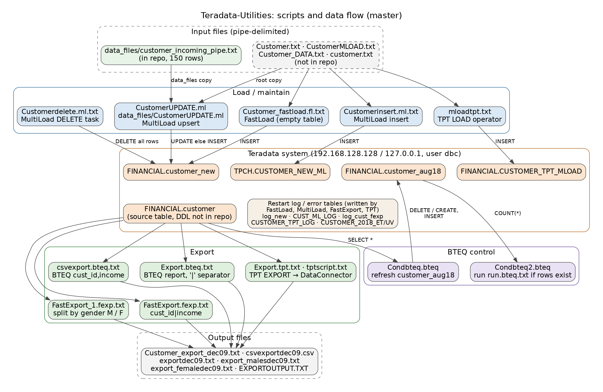

# Teradata-Utilities

Example Teradata utility scripts for one customer table: loading it with FastLoad, MultiLoad and
Teradata Parallel Transporter (TPT), refreshing a copy with conditional BTEQ, and exporting it with
BTEQ, FastExport and TPT. The `data_files/` folder holds a sample existing/incoming customer data set
and the expected result of the MultiLoad upsert.

There is no build, wrapper script or scheduler: each file is run on its own by the matching Teradata
Tools and Utilities (TTU) client against a Teradata system.

- **Architecture and data flow:** [docs/architecture.md](docs/architecture.md)
- **Diagram:** [PNG](docs/diagrams/architecture.png) · [SVG](docs/diagrams/architecture.svg) ·
  editable Graphviz source [docs/diagrams/architecture.dot](docs/diagrams/architecture.dot)



## Scripts

| File | Utility | What it does |
| --- | --- | --- |
| `Customer_fastload.fl.txt` | FastLoad | Loads pipe-delimited `Customer.txt` into the empty table `FINANCIAL.customer_new`. |
| `Customerinsert.ml.txt` | MultiLoad | Inserts pipe-delimited `CustomerMLOAD.txt` into `tpch.CUSTOMER_NEW_ML`. |
| `CustomerUPDATE.ml` | MultiLoad | Upserts `Customer_DATA.txt` into `financial.customer_new`: updates `years_with_bank`, `income`, `age` by `cust_id`, inserts missing rows. |
| `data_files/CustomerUPDATE.ml` | MultiLoad | Same upsert, with `<TERADATA_HOST>/<TERADATA_USER>,<TERADATA_PASSWORD>` placeholders, reading `customer_incoming_pipe.txt`. |
| `Customerdelete.ml.txt` | MultiLoad | DELETE task that removes every row from `financial.customer_new`. |
| `mloadtpt.txt` | TPT | Job `LOAD_FROM_FILE`: DataConnector reads `customer.txt`, LOAD operator inserts into `FINANCIAL.CUSTOMER_TPT_MLOAD`. |
| `Condbteq.bteq` | BTEQ | Empties `customer_aug18`, creates it if the delete fails, then copies `customer` into it. |
| `Condbteq2.bteq` | BTEQ | Counts `customer_aug18`; quits if empty, otherwise runs `run.bteq.txt` (not in this repo). |
| `Export.bteq.txt` | BTEQ | Report export of `customer` with a `\|` separator to `Customer_export_dec09.txt`. |
| `csvexport.bteq.txt` | BTEQ | Exports `cust_id,income` from `customer` to `csvexportdec09.csv`. |
| `FastExport.fexp.txt` | FastExport | Exports `cust_id\|income` from `financial.customer` to `exportdec09.txt`. |
| `FastExport_1.fexp.txt` | FastExport | Two exports of `financial.customer`: males to `export_malesdec09.txt`, females to `export_femaledec09.txt`. |
| `Export.tpt.txt`, `tptscript.txt` | TPT | Job `Export_to_File`: EXPORT operator reads `FINANCIAL.CUSTOMER`, DataConnector writes `EXPORTOUTPUT.TXT`. The two files differ only in `TdpId` and indentation. |

## Sample data (`data_files/`)

| File | Rows | Contents |
| --- | --- | --- |
| `customer_existing.csv` | 500 + header | Starting contents of the customer table, `C0001`–`C0500`. |
| `customer_incoming.csv` | 150 + header | Incoming batch: 100 existing ids (every fifth, `C0005`–`C0500`) and 50 new ids (`C0501`–`C0550`). |
| `customer_incoming_pipe.txt` | 150 | The same incoming rows, pipe-delimited with no header: the MultiLoad input. |
| `target_output.csv` | 550 + header | Expected table after the upsert. |

All files use the columns `cust_id,income,age,years_with_bank,nbr_children,gender,marital_status`.
How the expected output follows from the upsert, and a command that checks it, are in
[docs/architecture.md](docs/architecture.md#sample-data-and-the-upsert).

## Running a script

You need a reachable Teradata system and the TTU clients (`bteq`, `fastload`, `mload`, `fexp`, `tbuild`).
None of them can run without one. Before running a script:

1. Replace the hard-coded logon (`192.168.128.128/dbc,dbc`, or `TdpId`/`USERNAME`/`USERPASSWORD` in the
   TPT jobs) with your own system and credentials.
2. Point the input and output paths (many are `C:\Users\SARAVANA\Desktop\Edureka\...`) at real files.
3. Create the target tables. The repo has DDL only for `FINANCIAL.customer_aug18` (in `Condbteq.bteq`).

Then run it with its utility, for example:

```sh
bteq < Condbteq.bteq
fastload < Customer_fastload.fl.txt
(cd data_files && mload < CustomerUPDATE.ml)   # reads customer_incoming_pipe.txt from the working directory
fexp < FastExport.fexp.txt
tbuild -f Export.tpt.txt
```

See [docs/architecture.md](docs/architecture.md) for the order the load scripts expect and the
restart log and error tables each one writes.
