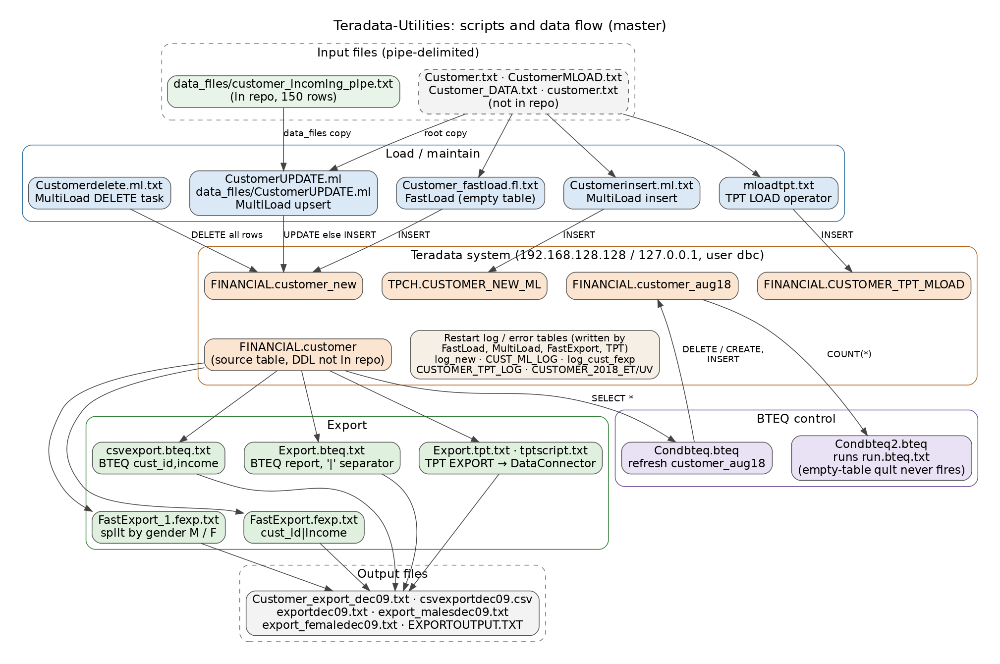

# Architecture: Teradata-Utilities

This repository is a set of standalone Teradata client scripts that move one customer data set
between flat files and Teradata tables. Every script logs on to the Teradata system itself and is run
on its own by the matching Teradata Tools and Utilities (TTU) client. There is no shared code, no
configuration file, no job scheduler and no automated test in the repo.



Diagram source: [diagrams/architecture.dot](diagrams/architecture.dot) (Graphviz). After editing it,
run `docs/diagrams/render.sh` (needs `dot`) to regenerate [architecture.png](diagrams/architecture.png)
and [architecture.svg](diagrams/architecture.svg).

## Components

| Layer | Files | TTU client |
| --- | --- | --- |
| Load / maintain | `Customer_fastload.fl.txt`, `Customerinsert.ml.txt`, `CustomerUPDATE.ml`, `data_files/CustomerUPDATE.ml`, `Customerdelete.ml.txt`, `mloadtpt.txt` | `fastload`, `mload`, `tbuild` |
| BTEQ control | `Condbteq.bteq`, `Condbteq2.bteq` | `bteq` |
| Export | `Export.bteq.txt`, `csvexport.bteq.txt`, `FastExport.fexp.txt`, `FastExport_1.fexp.txt`, `Export.tpt.txt`, `tptscript.txt` | `bteq`, `fexp`, `tbuild` |
| Sample data | `data_files/*.csv`, `data_files/customer_incoming_pipe.txt` | none (input and expected output) |

## Shared conventions

- **Logon.** Every root-level script hard-codes the logon. BTEQ, FastLoad, MultiLoad and FastExport use
  `.logon 192.168.128.128/dbc,dbc;`. The TPT jobs set `TdpId`, `USERNAME = 'dbc'` and
  `USERPASSWORD = 'dbc'` in the operator attributes: `127.0.0.1` in `Export.tpt.txt` and
  `mloadtpt.txt`, `198.168.128.128` in `tptscript.txt`. Only `data_files/CustomerUPDATE.ml` uses
  placeholders (`<TERADATA_HOST>/<TERADATA_USER>,<TERADATA_PASSWORD>`).
- **Databases.** Everything targets the `FINANCIAL` database except `Customerinsert.ml.txt`, which
  loads `tpch.CUSTOMER_NEW_ML` and keeps its log table in `tpch`.
- **Record layout.** All scripts use the seven customer columns `cust_id, income, age,
  years_with_bank, nbr_children, gender, marital_status`. Loaders read every field as `VARCHAR`
  from pipe-delimited text (`SET RECORD VARTEXT '|'`, `FORMAT VARTEXT'|'`, or TPT
  `FORMAT = 'DELIMITED'` with `TEXTDELIMITER = '|'`) and let Teradata convert on insert.
- **Table definitions.** The only DDL in the repo is `CREATE MULTISET TABLE FINANCIAL.customer_aug18`
  in `Condbteq.bteq` (`cust_id INTEGER NOT NULL`, `income INTEGER`, `age`, `years_with_bank` and
  `nbr_children SMALLINT`, `gender` and `marital_status CHAR(1)`, primary index `cust_id`). The other
  tables must already exist.
- **Paths.** Most input and output files are absolute Windows paths under
  `C:\Users\SARAVANA\Desktop\Edureka\`. `CustomerUPDATE.ml`, `data_files/CustomerUPDATE.ml` and the
  TPT jobs use paths relative to the working directory.
- **Files.** Root scripts have CRLF line endings, and most carry a `.txt` suffix after the utility
  extension (`.fl.txt`, `.ml.txt`, `.fexp.txt`). The utilities read the script on standard input or
  with `tbuild -f`, so the name does not matter to them.

## Load path

The three scripts that write `FINANCIAL.customer_new` form one cycle:

1. **`Customerdelete.ml.txt` (MultiLoad DELETE task).** `.BEGIN DELETE MLOAD TABLES` followed by an
   unconditional `DELETE FROM financial.customer_new;` empties the table. Log table
   `financial.CUST_ML_LOG`.
2. **`Customer_fastload.fl.txt` (FastLoad).** `BEGIN LOADING FINANCIAL.customer_new` with error tables
   `CUSTOMER_2018_ET` and `CUSTOMER_2018_UV` and `CHECKPOINT 100`, then `INSERT`s every record of
   `Customer.txt`. FastLoad only loads an empty table, which is why step 1 exists.
3. **`CustomerUPDATE.ml` (MultiLoad upsert).** DML label `UPDCUST` with
   `DO INSERT FOR MISSING UPDATE ROWS`: for each input record it runs
   `UPDATE ... SET YEARS_WITH_BANK, income, age WHERE CUST_ID = :in_cust_id`, and when no row matches
   it runs the `INSERT` of all seven columns. `nbr_children`, `gender` and `marital_status` of
   existing rows are never changed. Log table `financial.log_new`. The root copy reads
   `Customer_DATA.txt`; `data_files/CustomerUPDATE.ml` is the same job reading
   `customer_incoming_pipe.txt`, and is the one the sample data in `data_files/` is built for.

Two loaders write other tables:

- **`Customerinsert.ml.txt` (MultiLoad insert).** DML label `INSTCUST` inserts every record of
  `CustomerMLOAD.txt` into `tpch.CUSTOMER_NEW_ML`. Log table `tpch.CUST_ML_LOG`.
- **`mloadtpt.txt` (TPT).** Job `LOAD_FROM_FILE` with two operators: `FILE_READER`
  (`DATACONNECTOR PRODUCER`, delimited `customer.txt`) feeds `LOAD_CUSTOMER` (`TYPE LOAD`,
  2 sessions), which inserts into `FINANCIAL.CUSTOMER_TPT_MLOAD` with log table
  `FINANCIAL.CUSTOMER_TPT_LOG`. Despite the file name, the LOAD operator uses the FastLoad protocol
  (the job description says "USING FLOADInvocation"), so the target table must be empty.

## BTEQ control flow

- **`Condbteq.bteq`** refreshes a dated copy of the source table:
  `delete from customer_aug18;` then `.IF ERRORCODE=0 THEN .GOTO INSERT_DEMO;`. If the delete
  succeeds the table exists and the `CREATE MULTISET TABLE` is skipped; if it fails (table missing)
  BTEQ falls through to the `CREATE`. Both paths reach `.LABEL INSERT_DEMO` and run
  `insert into customer_aug18 select * from customer;`.
- **`Condbteq2.bteq`** gates a follow-on script: `select Count(*) from customer_aug18;` then
  `.IF ACTIVITYCOUNT=0 THEN .QUIT;`, otherwise `.RUN FILE=C:\Users\SARAVANA\Desktop\Edureka\BTEQ\run.bteq.txt`.
  `ACTIVITYCOUNT` is the number of rows the `SELECT` returned, which is always 1 for a `COUNT(*)`, so
  by BTEQ's rules the quit branch is never taken (see [Known issues](#known-issues)). `run.bteq.txt` is not in the
  repo.

Run `Condbteq.bteq` before `Condbteq2.bteq`: the second reads the table the first fills.

## Export path

All exports read `FINANCIAL.customer`.

| Script | Client | Output file | Format |
| --- | --- | --- | --- |
| `Export.bteq.txt` | BTEQ `.export report` | `C:\...\Edureka\Customer_export_dec09.txt` | Report with column headings, `.set separator '\|'`, all columns |
| `csvexport.bteq.txt` | BTEQ `.EXPORT FILE` (no mode named, so BTEQ's default DATA mode) | `C:\...\Edureka\csvexportdec09.csv` | One concatenated `cust_id,income` column |
| `FastExport.fexp.txt` | FastExport, 2 sessions, `MODE RECORD FORMAT TEXT` | `C:\...\Edureka\20170107\exportdec09.txt` | `cust_id\|income`, each cast to `CHAR(20)` |
| `FastExport_1.fexp.txt` | FastExport, two `.BEGIN EXPORT` tasks | `...\20170107\export_malesdec09.txt`, `...\20170107\export_femaledec09.txt` | Fixed-width `cust_id`, `income` (`CHAR(10)`), `age`, `gender` (`CHAR(5)`), filtered on `gender = 'M'` / `'F'` |
| `Export.tpt.txt`, `tptscript.txt` | TPT job `Export_to_File` | `EXPORTOUTPUT.TXT` (working directory) | `EXPORT_CUSTOMER` (`TYPE EXPORT`, 2 sessions) casts all columns to `CHAR`; `FILE_WRITER` (`DATACONNECTOR CONSUMER`, `FORMAT = 'TEXT'`) writes fixed-width records |

## Tables

| Table | Written by | Read by |
| --- | --- | --- |
| `FINANCIAL.customer` | nothing in the repo | `Condbteq.bteq`, every export script |
| `FINANCIAL.customer_new` | `Customer_fastload.fl.txt`, `CustomerUPDATE.ml`, `data_files/CustomerUPDATE.ml`, `Customerdelete.ml.txt` | nothing in the repo |
| `FINANCIAL.customer_aug18` | `Condbteq.bteq` (creates it if missing) | `Condbteq2.bteq` |
| `FINANCIAL.CUSTOMER_TPT_MLOAD` | `mloadtpt.txt` | nothing in the repo |
| `tpch.CUSTOMER_NEW_ML` | `Customerinsert.ml.txt` | nothing in the repo |

Restart log and error tables the utilities create and use:

| Table | Utility and script |
| --- | --- |
| `financial.log_new` | MultiLoad log, both `CustomerUPDATE.ml` copies |
| `financial.CUST_ML_LOG` | MultiLoad log, `Customerdelete.ml.txt` |
| `tpch.CUST_ML_LOG` | MultiLoad log, `Customerinsert.ml.txt` |
| `financial.log_cust_fexp` | FastExport log, both `.fexp.txt` scripts |
| `FINANCIAL.CUSTOMER_TPT_LOG` | TPT LOAD operator log, `mloadtpt.txt` |
| `CUSTOMER_2018_ET`, `CUSTOMER_2018_UV` | FastLoad error tables in the default database (`FINANCIAL`), `Customer_fastload.fl.txt` |

MultiLoad also creates its default work and error tables for each target table.

## Sample data and the upsert

`data_files/` is a worked example of the upsert in `data_files/CustomerUPDATE.ml`:

- `customer_existing.csv`: 500 rows, `C0001`–`C0500`, the table before the job.
- `customer_incoming.csv`: 150 rows. 100 reuse existing ids (every fifth id, `C0005`–`C0500`) and 50
  are new (`C0501`–`C0550`). Every incoming row has `gender = X` and `marital_status = Z`, so the
  output shows which rows were inserted rather than updated.
- `customer_incoming_pipe.txt`: the same 150 rows, pipe-delimited and without a header: the file the
  job imports.
- `target_output.csv`: 550 rows. The 100 matched rows take `income`, `age` and `years_with_bank`
  from the incoming batch and keep their own `nbr_children`, `gender` and `marital_status`; the 50
  new rows are inserted whole (with `X`/`Z`).

The CSV files have CRLF line endings and a header; the pipe file has LF endings and no header.
This command replays the upsert rules in Python and checks both relationships without a Teradata
system; run it from the repository root:

```sh
python3 - <<'PY'
import csv
read = lambda p: {r["cust_id"]: r for r in csv.DictReader(open(p, newline=""))}
existing = read("data_files/customer_existing.csv")
incoming = list(csv.DictReader(open("data_files/customer_incoming.csv", newline="")))
pipe = [line.rstrip("\r\n").split("|") for line in open("data_files/customer_incoming_pipe.txt")]
assert pipe == [list(r.values()) for r in incoming], "pipe file differs from customer_incoming.csv"
table = {k: dict(v) for k, v in existing.items()}
for r in incoming:
    if r["cust_id"] in table:  # UPDATE ... SET years_with_bank, income, age
        table[r["cust_id"]].update({c: r[c] for c in ("years_with_bank", "income", "age")})
    else:                      # DO INSERT FOR MISSING UPDATE ROWS
        table[r["cust_id"]] = dict(r)
assert table == read("data_files/target_output.csv"), "target_output.csv does not match the upsert"
print(f"OK: {len(existing)} existing + {len(incoming)} incoming -> {len(table)} rows")
PY
```

Expected output: `OK: 500 existing + 150 incoming -> 550 rows`.

The sample ids are strings (`C0001`). Loading them needs a character `cust_id` column; the
`INTEGER` `cust_id` of the one table defined in the repo (`customer_aug18`) would reject them.

## Verification

Checked against `master` when this document was written:

- Every file, table, label, path, operator and attribute named here was read from the scripts.
- The sample-data command above was run and printed `OK: 500 existing + 150 incoming -> 550 rows`.
- `docs/diagrams/render.sh` was run with Graphviz to produce the PNG and SVG.

Not tested: no script was run, because that needs a Teradata system and the licensed TTU clients
(`bteq`, `fastload`, `mload`, `fexp`, `tbuild`). Syntax, runtime behaviour, restart behaviour and the
example commands in the README are taken from reading the scripts and are unverified.

## Known issues

Found while documenting; the scripts are left unchanged.

- Hard-coded `dbc`/`dbc` credentials and host addresses in every root script.
- `tptscript.txt` points at `TdpId = '198.168.128.128'`, while every other script uses
  `192.168.128.128` or `127.0.0.1`; it looks like a typo. Otherwise it duplicates `Export.tpt.txt`.
- `Condbteq2.bteq`: `ACTIVITYCOUNT` after `SELECT COUNT(*)` is 1 even for an empty table, so the
  `.QUIT` branch never fires; and `run.bteq.txt` is not in the repo.
- `FastExport_1.fexp.txt`: the female export runs an extra
  `select distinct cast('custid  ||  income' as char(50))` before the real query, so the output gets
  a literal `custid  ||  income` row, and the male export has no such row.
- `csvexport.bteq.txt` names no export mode, and BTEQ's default for `.EXPORT FILE` is DATA (binary
  records with length prefixes), not REPORT, so the `.csv` output is probably not plain text.
  Not tested.
- `Customerinsert.ml.txt` ends with `LOGOFF;` and `csvexport.bteq.txt` with `logoff;`, without the
  leading dot used by every other script. Whether each utility accepts that was not tested.
- Input files `Customer.txt`, `CustomerMLOAD.txt`, `Customer_DATA.txt` and `customer.txt`, and DDL
  for every table except `customer_aug18`, are not in the repo.
- The sample data's alphanumeric `cust_id` does not fit the `INTEGER` `cust_id` in the only DDL in
  the repo.
